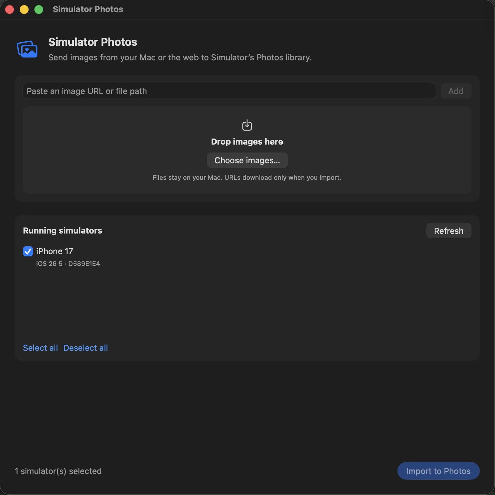

# Simulator photos importer

A standalone native macOS GUI for importing images into running Apple simulators’ Photos libraries. It does not use the `simphoto` shell function, need your shell configuration, or require the MOHRE app.

## Interface example

Example with one running simulator selected. Add images, choose the destination simulators, then click **Import to Photos**. This screenshot shows an earlier build titled “Simulator Photos”; the current app is named **Simulator photos importer**.

## Download

Download **Simulator photos importer.zip** from the [latest GitHub release](https://github.com/AhmedMHassaan/simulator-photos-importer/releases/latest). Unzip it, open the extracted folder, and move the app to Applications. The ZIP includes the app, README, and user guide. No terminal or rebuild is needed.

Requires macOS 13 or later, Xcode with an iOS simulator runtime installed, and at least one running simulator. Both Apple Silicon and Intel Macs are supported. The current build is locally signed and not Apple-notarized; see [Apple verification](#apple-verification) if macOS blocks it.

## Why this app exists

When the new Device Hub does not support dragging and dropping image files into a simulator, this app provides a direct import workflow. Drag images into **Simulator photos importer**, select one or more running simulators, and add the images to their Photos libraries. This addresses the Device Hub limitation encountered in the original workflow; behavior may vary by Xcode version and setup.

## User guide

Read the [step-by-step user guide](USER_GUIDE.md) for installation, image URLs and file paths, drag and drop, simulator selection, importing, and troubleshooting. The portable ZIP includes this guide and the README alongside the app.

## Use the app

1. Open **Simulator photos importer.app** (in `dist/` when using the source project).
2. Start the simulators you want to use, then click **Refresh**.
3. Paste an image URL or local file path and click **Add**, use **Choose images…**, or drag image files from Finder into the drop area. Multiple images are supported.
4. Check the destination simulators and click **Import to Photos**.
5. Open **Photos** inside each selected simulator to see the images.

The first successful refresh selects all currently running simulators. You can select any subset or deselect all. Matching simulator names are distinguished by runtime and device ID. Each image and destination gets its own success or failure result; failures do not prevent other imports.

Images are registered using Apple’s `simctl addmedia`, which maintains the simulator’s Photos library correctly. This does not copy files into an individual app’s Documents directory. URLs must return an image directly; webpages and HTTP errors are rejected. Downloads are temporary and removed after import. Local originals remain untouched. Importing the same image again can create a duplicate in Photos.

## Move to another Mac

Copy **Simulator photos importer.zip** (in `dist/` when using the source project) to the other Mac, unzip it, open the extracted folder, and move the app to Applications or another folder. No build, package manager, or terminal is needed to use it.

- macOS 13 Ventura or later, Apple Silicon or Intel.
- Xcode must be installed and its initial setup completed, with an iOS simulator runtime installed and at least one simulator running. Xcode Command Line Tools alone do not include iOS simulators.
- The app uses that Mac’s active Xcode installation. If simulator discovery fails, open Xcode and check **Settings → Locations → Command Line Tools**.
- This build is locally signed, without an Apple Developer ID or notarization. macOS may require explicit permission to open it after transfer. Public distribution without this prompt requires Developer ID signing and Apple notarization.

## Apple verification

The current build is locally signed and is not Apple-notarized. If macOS blocks a trusted copy after transfer, try opening it once, then use **System Settings → Privacy & Security → Open Anyway** and confirm. See the [user guide’s Apple verification instructions](USER_GUIDE.md#apple-verification-when-opening-the-app) and [Apple’s guidance](https://support.apple.com/102445).

For notarized distribution, the developer needs an Apple Developer Program membership, a **Developer ID Application** certificate, and a successful notarization submission followed by ticket stapling. The user guide explains this process and links to Apple’s documentation.

## Source and rebuilding

Open `SimulatorPhotos.xcodeproj` in Xcode and build the **SimulatorPhotos** scheme, or run `Build.command` with XcodeBuildMCP installed. Release builds contain both `arm64` and `x86_64` code. There are no third-party runtime dependencies.

`project.yml` is the XcodeGen source of the project; regenerate with `xcodegen generate` after changing it. `Tools/GenerateIcon.swift` creates the native icon artwork.

The test target checks file and URL parsing, simulator identity and filtering, image validation and copying, queue rules, and HTTP image/HTML/error responses using a local server. Set the test runner environment variable `SIMULATOR_PHOTOS_LIVE_TEST=1` to additionally import a small blue test image into the first running simulator.

## Developer

Developed by [Ahmed Mohamed Hassaan](https://www.linkedin.com/in/ahmedmhassaan/) · LinkedIn: @ahmedmhassaan.
