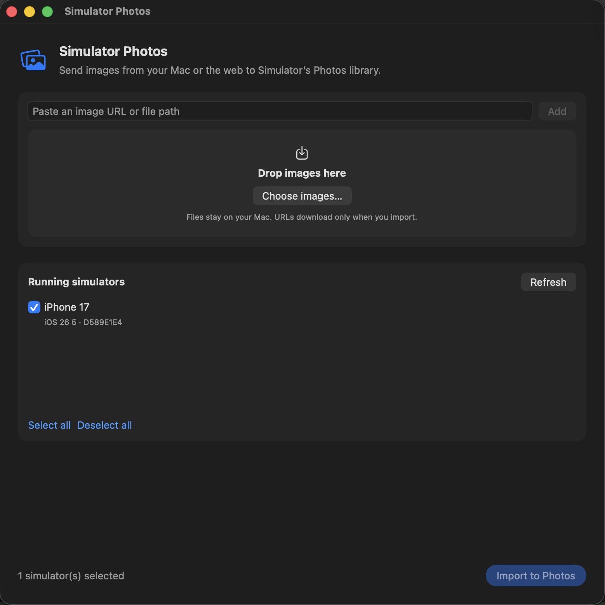

# Simulator photos importer — User guide

Developed by [Ahmed Mohamed Hassaan](https://www.linkedin.com/in/ahmedmhassaan/) · LinkedIn: **@ahmedmhassaan**.

Import images from your Mac or an image URL into the Photos library of one or more running iOS simulators, using a graphical interface.

## Interface example



Example with one running simulator selected. Add images, choose the destination simulators, then click **Import to Photos**. This screenshot shows an earlier build titled “Simulator Photos”; the current app is named **Simulator photos importer**.

## Why this app exists

This utility addresses the workflow where the new Device Hub does not support dragging and dropping image files into a simulator. Instead, drop files into **Simulator photos importer**, select the running simulators, and import the images into their Photos libraries. You can also choose files or paste an image URL or local file path.

This describes the Device Hub limitation encountered in the original workflow; behavior may differ between Xcode versions and setups. Drag and drop into this utility is supported.

## 1. What you need

- A Mac running macOS 13 Ventura or later. Intel and Apple Silicon Macs are supported.
- Xcode installed, opened at least once, with initial setup completed.
- An iOS simulator runtime installed through Xcode.
- At least one running simulator.

You do not need Terminal, the `simphoto` command, or any other project to use the app. Xcode Command Line Tools alone do not include the iOS Simulator.

## 2. Install and open

1. Copy **Simulator photos importer.zip** to your Mac.
2. Double-click the ZIP to extract it.
3. Open the extracted **Simulator photos importer** folder. It contains the app, this guide, and the README.
4. Drag **Simulator photos importer.app** into your **Applications** folder, or keep it in another folder of your choice.
5. Double-click the app to open it.

This build is locally signed and is not Apple-notarized. macOS may ask you to explicitly allow it to open after transfer.

## Apple verification when opening the app

The downloadable build is locally signed and has not been notarized by Apple. On another Mac, you may see a warning that Apple cannot verify the developer or check the app for malicious software.

If you trust the copy you received:

1. Try opening **Simulator photos importer.app** once, then dismiss the warning.
2. Open **System Settings → Privacy & Security**.
3. Find the blocked-app message and click **Open Anyway**.
4. Confirm that you want to open the app, authenticating if asked.

This grants an exception on that Mac; it does not notarize the app. Organization-managed Macs may restrict this option. Only approve a copy from a source you trust. See [Apple’s instructions for opening apps safely](https://support.apple.com/102445).

For a developer to distribute an Apple-notarized build:

1. Enroll in the **Apple Developer Program** and obtain a **Developer ID Application** signing certificate.
2. Sign the release app with Developer ID and hardened runtime enabled.
3. Submit it to Apple’s notarization service. Xcode’s **Archive → Distribute App → Developer ID** workflow can handle distribution signing and notarization.
4. After Apple accepts it, attach the notarization ticket to the app (stapling), verify the result, and create a new ZIP from that app.

Notarization does not require publishing the app in the Mac App Store. See [Apple’s notarization documentation](https://developer.apple.com/documentation/security/notarizing-macos-software-before-distribution).

## 3. Start your simulators

1. Open Xcode.
2. Use **Xcode → Open Developer Tool → Simulator** to open Simulator.
3. In Simulator, use **File → Open Simulator** to start the devices you want to use.
4. Wait until each device finishes starting.
5. Return to Simulator photos importer and click **Refresh**.

Only running simulators appear in the list. If you start or close another simulator, click **Refresh** again.

## 4. Add images

You can combine all three methods in one import.

### Choose image files

1. Click **Choose images…**.
2. Select one or more images from your Mac. Hold Command to select multiple files.
3. Click **Add images**.

You can also press **Command + O** to open the file chooser.

### Drag and drop

Drag one or more image files from Finder onto **Drop images here**. Their file paths appear in the queue automatically; you do not need to copy the paths yourself.

### Paste a file path

Paste a local path into the input field, then click **Add** or press Return.

Examples:

```text
/Users/yourname/Pictures/sample photo.png
~/Pictures/sample photo.jpg
file:///Users/yourname/Pictures/sample%20photo.png
```

Paths containing spaces are supported. Use a normal Finder path rather than a shell-escaped path.

### Paste an image URL

Paste a direct `https://` or `http://` image URL and click **Add** or press Return.

For example, a URL ending in `/photo.jpg` can work if it returns an actual image. A webpage containing an image, a sign-in page, or an image search results page will not work. URLs do not have to end in an image extension, but their response must be a readable image.

The app downloads URL images when you click **Import to Photos**. You will need network access to the image host at that time. The app does not provide a sign-in flow or custom authentication headers for protected URLs.

### Review the queue

- Check the queued file paths and URLs before importing.
- Click the **×** beside an entry to remove it.
- Click **Clear** to empty the queue.
- Adding the exact same file path or URL again does not add another queue entry.

## 5. Select the destination simulators

Use the checkbox beside each simulator to choose where the images should go.

- **Select all** chooses every listed simulator.
- **Deselect all** clears the selection.
- Check any combination to import into several simulators in one operation.
- The runtime and short device ID help distinguish devices with the same name.

The first successful refresh selects the currently running simulators. Review the checkboxes before importing. At least one queued image and one selected simulator are required to enable **Import to Photos**.

## 6. Import and view the images

1. Click **Import to Photos**.
2. Wait for the progress message to finish.
3. Review the results. Each image and simulator pair receives a success or failure result. An image that cannot be prepared receives an error before any simulator import is attempted for that image.
4. Open the **Photos** app inside each selected simulator to view the imported images.

For example, two images imported into three selected simulators produce six destination results if both images can be prepared successfully.

The files are added to the simulator’s Photos library. They are not copied into an individual app’s Documents folder. Original files on your Mac remain unchanged. Temporary downloads are cleaned up after import. The queue remains available after importing; importing it again may create duplicate photos.

## 7. Troubleshooting

| Problem | What to try |
| --- | --- |
| No simulators appear | Start a simulator, wait for it to boot, then click **Refresh**. |
| The simulator tools cannot be found | Open Xcode and complete setup. In **Xcode → Settings → Locations**, check that **Command Line Tools** points to your installed Xcode. |
| **Import to Photos** is disabled | Add at least one image and check at least one simulator. Wait for any current refresh or import to finish. |
| A file cannot be read | Confirm the image exists. Use **Choose images…** to select it again, especially if it was moved or renamed. |
| A URL fails to download | Check network access and use a direct image URL that opens without signing in. |
| A response is not a readable image | The URL may return HTML or an unsupported/corrupt file. Try a valid PNG or JPEG image. |
| One destination fails | Confirm that simulator is still running. Click **Refresh**, select it, and retry. Successful destinations may receive duplicates if selected again. |
| An operation times out | Check that the simulator responds normally, refresh the list, and retry. |
| An image is missing from your app’s file browser | Open **Photos** inside the simulator. Imports go to the Photos library, not your app’s Documents folder. |

## 8. Share with another Mac

Send **Simulator photos importer.zip** to the other Mac and follow the installation steps above. No rebuilding is needed. The other Mac must meet the requirements in section 1. The utility discovers the simulators on that Mac; it does not transfer simulator devices or runtimes from your original Mac.

## Developer

**Developed by Ahmed Mohamed Hassaan**
LinkedIn: [@ahmedmhassaan](https://www.linkedin.com/in/ahmedmhassaan/)
